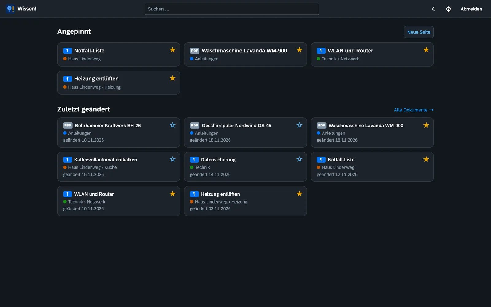
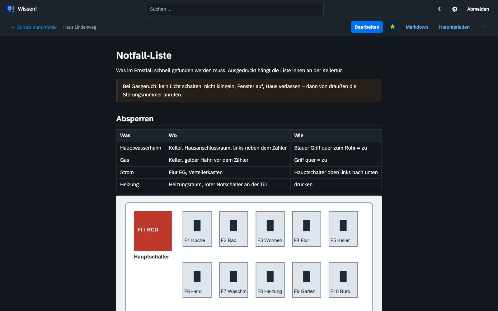
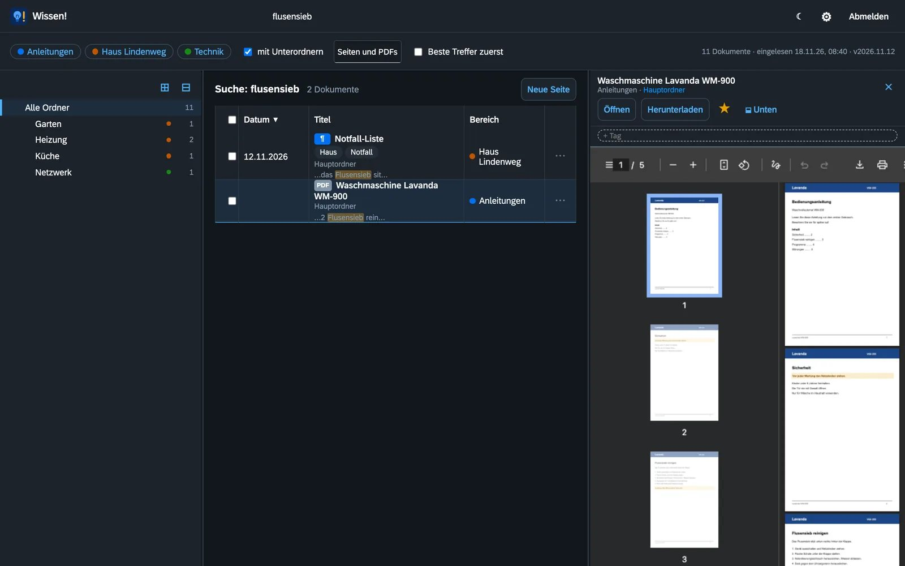
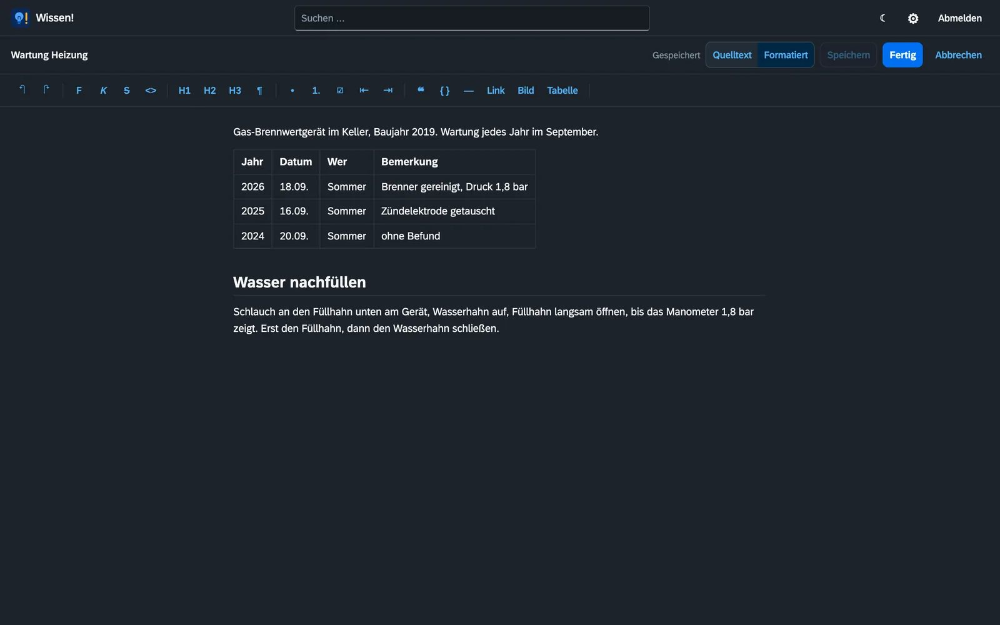
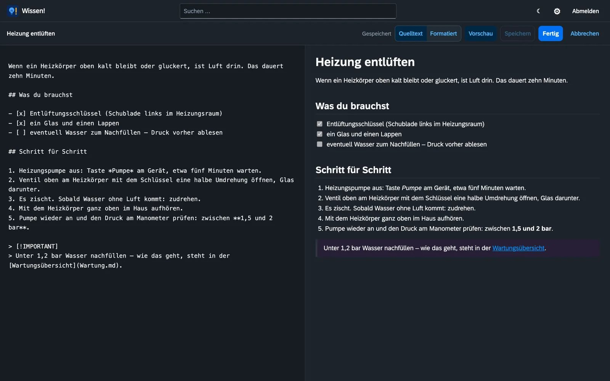

<p align="center"></p>

<h1 align="center">Wissen!</h1>

<p align="center"><b>Das Archiv für alles, was man wissen muss: eigene Notizen und Anleitungen als Seiten, Bedienungsanleitungen als PDF – nebeneinander, durchsuchbar, in ganz normalen Ordnern.</b><br>
Selbst gehostet · Open Source (AGPL-3.0) · Deutsch, Englisch, Französisch, Italienisch</p>

<p align="center"><a href="https://worldgate.de/wissen/"><b>Website</b></a> · <a href="https://worldgate.de/wissen/handbuch/">Handbuch</a> · <i>English: <a href="README.md">README.md</a></i></p>



## Der Grundgedanke

**Ordner sind die Wahrheit.** Eine Seite ist eine gewöhnliche Markdown-Datei, eine Anleitung eine gewöhnliche PDF. Wissen! liest die Ordner, macht alles durchsuchbar und zeigt es an. Ist das Programm aus, bleibt das Archiv in jedem Dateimanager lesbar – und was du dort von Hand ablegst, taucht in Wissen! auf.

Wissen! ist die Schwester von [Ordnung!](https://github.com/orohde/Ordnung) (Dokumentenarchiv) und [Augenblick!](https://github.com/orohde/Augenblick) (Fotos): gleiches Aussehen, gleiche Bedienung.

## Was es kann

- **Seiten und PDFs gleichberechtigt.** Die Notfall-Liste, die du selbst schreibst, und die Anleitung der Waschmaschine stehen im selben Baum und kommen in derselben Suche. Eine Seite kann direkt auf Seite 3 einer PDF verweisen (`anleitung.pdf#page=3`).
- **Volltextsuche** über Titel, Ordner und den Text jeder Seite und jeder PDF, auch bei Scans ohne Textebene (Tesseract-OCR, Deutsch und Englisch, auf dem eigenen Rechner). `#tag` filtert nach Schlagworten.
- **Fragen ans Archiv (optional, mit KI).** Eine Frage ins Suchfeld tippen – Wissen! sucht die passenden Stellen aus Seiten und PDFs heraus, lässt eine KI daraus antworten und nennt die Quellen bis zur PDF-Seite. An den Anbieter gehen nur die Frage und diese Textstellen. Als Anbieter gehen Claude, ein eigener Ollama-Server oder ein anderer OpenAI-kompatibler Server; ausgeschaltet, bis du es unter *Einstellungen → KI* einschaltest.
- **Schreiben in zwei Ansichten.** *Formatiert* zeigt die Seite so, wie sie später aussieht, mit einer Leiste für Fett, Listen, Aufgaben, Links, Bilder und Tabellen. *Quelltext* zeigt das Markdown mit der Vorschau daneben. Welche Ansicht du zuletzt benutzt hast, merkt sich Wissen! für dein Konto.
- **Schreiben ohne Angst.** Beim Speichern aus der formatierten Ansicht werden nur die Absätze neu geschrieben, die du angefasst hast; der Rest bleibt Zeichen für Zeichen in der Datei. Vor dem Speichern liest Wissen! das Ergebnis zurück und vergleicht es mit dem, was du siehst.
- **Versionen.** Jede Fassung vor einem Speichern bleibt erhalten, lässt sich mit dem jetzigen Stand vergleichen und zurückholen.
- **Sperre statt Durcheinander.** Wer eine Seite bearbeitet, hält sie; andere sehen, wer gerade schreibt. Die Sperre läuft von selbst ab, wenn der Editor zu ist.
- **Startseite.** Wissen! öffnet mit dem, was du angepinnt hast, und dem zuletzt Geänderten. Jede Person pinnt für sich.
- **Hinweiskästen, Aufgabenlisten, Tabellen, Bilder.** Bilder einer Seite liegen in einem Ordner gleich daneben (`<Seite>.assets/`) und lassen sich beim Schreiben einfügen oder hineinziehen.
- **Neue Seite, Umbenennen, Verschieben, Papierkorb.** Beim Umbenennen und Verschieben zieht Wissen! die Links nach, die auf das Dokument zeigen. Gelöschtes bleibt 30 Tage im Papierkorb (einstellbar) und lässt sich zurückholen.
- **Bereiche und Rechte.** Ein Bereich ist ein Hauptordner, etwa je Thema, Haushalt oder Person. Rechte gibt es je Person und Bereich: kein Zugriff, lesen oder lesen und schreiben.
- **Lesebreite und Schriftgröße** per Schieber, je Konto gemerkt. Hell und dunkel.
- **REST-API und MCP.** Alles, was die Oberfläche kann, geht auch per API (ausprobierbar unter `/api/docs`). Für KI-Assistenten gibt es einen MCP-Endpunkt unter `/api/mcp`. Schlüssel legst du unter *Einstellungen → API* an, nur lesend oder lesend und schreibend.
- **Zweiter Faktor** für die Anmeldung, auf Wunsch Pflicht für den Zugang von außen.

<table>
<tr><td></td><td></td></tr>
<tr><td></td><td></td></tr>
</table>

## Schnellstart mit Docker

```yaml
services:
  wissen:
    image: ghcr.io/orohde/wissen:latest
    container_name: wissen
    restart: unless-stopped
    ports:
      - "8460:8000"
    volumes:
      - ./wissen:/wissen        # deine Seiten (.md) und PDFs – jeder Ordner direkt darunter ist ein Bereich
      - ./data:/data            # Inhaltsverzeichnis, Einstellungen, Konten, Versionen
    environment:
      - TZ=Europe/Berlin
```

```bash
docker compose up -d
```

Dann `http://localhost:8460` öffnen. Beim ersten Aufruf legst du dort den ersten Administrator an (nur aus dem Heimnetz möglich). Unter **Einstellungen → Ablage** legst du deinen ersten Bereich an, danach kannst du Seiten schreiben oder PDFs in den Ordner legen. Alles Weitere – Benutzer, Texterkennung, Heimnetz, API-Schlüssel – stellst du in der App ein, nicht in der Compose-Datei.

Das Image gibt es für `linux/amd64` und `linux/arm64` (Raspberry Pi, Apple Silicon).

### Einstellungen

Eingestellt wird in der App. In die Compose-Datei gehören nur Ordner, Port und, falls nötig, Benutzer:

| Variable | Standard | Bedeutung |
|---|---|---|
| `PUID` / `PGID` / `UMASK` | `99` / `100` / `0002` | Benutzer, Gruppe und umask, als die die App läuft, wenn der Container als root startet (bei `--user` ohne Wirkung) |
| `TZ` | `UTC` | Zeitzone, z. B. `Europe/Berlin` |
| `VERSIONSPRUEFUNG` | an | `0` schaltet die tägliche Frage nach neuen Versionen dauerhaft ab (siehe unten) |

Diese Variablen gelten nur als Vorgabe für eine frische Installation; sobald in der App etwas gespeichert ist, zählt die App:

| Variable | in der App unter |
|---|---|
| `WISSEN_ADMIN_USER` / `WISSEN_ADMIN_PASSWORD` | Einrichtungsseite beim ersten Aufruf (die Variablen legen das Konto nur an, solange es keins gibt) |
| `WISSEN_API_TOKEN` | *Einstellungen → API* (wird einmal übernommen) |
| `WISSEN_OCR`, `WISSEN_OCR_LANG`, `WISSEN_OCR_MAX_PAGES`, `WISSEN_RESCAN_MINUTES`, `WISSEN_TEXT_WORKERS` | *Einstellungen → System* |
| `WISSEN_INTERNAL_NETWORKS` | *Einstellungen → Sicherheit → Heimnetz* |

### Neue Versionen

Einmal am Tag fragt Wissen! bei `version.worldgate.de`, ob es eine neue Version gibt. Gibt es eine, sehen Admins oben einen Knopf mit Anleitung zum Aktualisieren. Übertragen werden dabei nur der Name der App, die installierte Version und die Installationsart (z. B. Docker), keine Kennung, keine Dokumente und keine Namen. Gespeichert werden dort nur Tagessummen, keine IP-Adressen. Abschalten lässt sich das unter *Einstellungen → System* oder dauerhaft mit `VERSIONSPRUEFUNG=0`.

### Anmeldung von außen

Hinter einem Reverse Proxy, der `X-Forwarded-For` **überschreibt** (Caddy tut das von sich aus), erkennt Wissen!, ob eine Anmeldung aus dem Heimnetz oder von außen kommt. Unter *Einstellungen → Sicherheit* lässt sich der Zugang von außen auf Konten mit zweitem Faktor beschränken (Authenticator-App, dazu zehn einmalige Wiederherstellungscodes). Anmeldungen von außen, gesperrte Konten und Änderungen am zweiten Faktor meldet Wissen! auf Wunsch über [ntfy](https://ntfy.sh).

### Für KI-Assistenten (MCP)

Der MCP-Zugang ist bei einer frischen Installation aus; ein Administrator schaltet ihn unter *Einstellungen → KI* ein. Der Endpunkt `/api/mcp` spricht das Model Context Protocol (Streamable HTTP) und nimmt denselben Schlüssel wie die REST-API als `Authorization: Bearer <Schlüssel>`. Die Werkzeuge: Bereiche und Ordner auflisten, suchen, lesen, Seite anlegen, ganz ersetzen, eine Textstelle ersetzen, anhängen, umbenennen, verschieben, Papierkorb und Versionen. Rechte, Sperre, Versionen und Papierkorb gelten dabei wie in der Oberfläche; ein Schlüssel mit Leserecht bekommt keine schreibenden Werkzeuge angeboten.

## Wie gespeichert wird

```
wissen/
  haus/Heizung/Heizung entlüften.md
  haus/Heizung/Heizung entlüften.assets/ventil.jpg
  anleitungen/Küche/Geschirrspüler Nordwind GS-45.pdf
  .papierkorb/2026-11-18/haus/Küche/Alte Notiz.md
```

Der Dateiname einer Seite ist ihr Titel. Was sonst zur Seite gehört, steht in einem kurzen Kopfblock oben in der Datei:

```markdown
---
title: Heizung entlüften
date: 2026-11-03
tags: [Heizung, Winter]
id: 3f9a1c2b7d
---
```

Die `id` bleibt beim Umbenennen und Verschieben gleich; an ihr hängen Versionen, Pins und Links der Oberfläche. SQLite ist nur ein Inhaltsverzeichnis und lässt sich jederzeit aus den Ordnern neu aufbauen. Frühere Fassungen liegen im Datenordner (`data/versions/`), nicht zwischen deinen Seiten; Schlagworte, Konten und Einstellungen als kleine JSON-Dateien daneben.

## Entwicklung

```bash
python -m venv .venv && .venv/bin/pip install -e '.[dev]'
.venv/bin/python -m pytest -q
WISSEN_ARCHIVE=./wissen WISSEN_DATA=./data WISSEN_ADMIN_PASSWORD=test-passwort-1 .venv/bin/python -m wissen
```

Python · FastAPI · SQLite FTS5 · pypdfium2 · Tesseract · PDF.js · marked · DOMPurify · SAP Fundamental Styles. Die Oberfläche braucht keinen Build-Schritt. Nur der formatierte Editor (Milkdown-Kern, ProseMirror, remark) wird einmal gebündelt; das fertige Bündel liegt im Repository, die Quellen und die Bauanleitung in [`editor/`](editor/).

## Lizenz

[GNU Affero General Public License v3.0](LICENSE). Freie Software, keine Kaufversion. Mehr unter [worldgate.de](https://worldgate.de).
