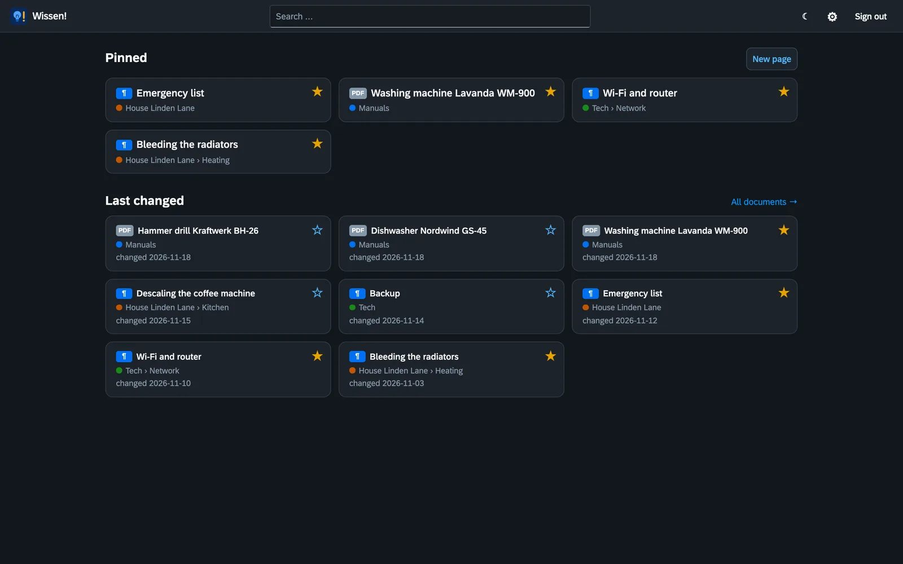
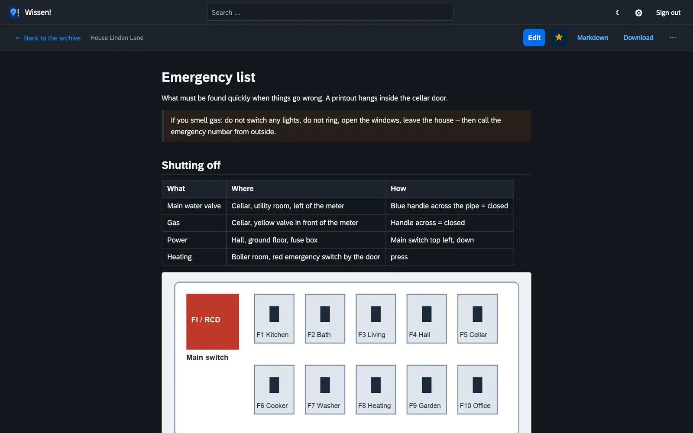
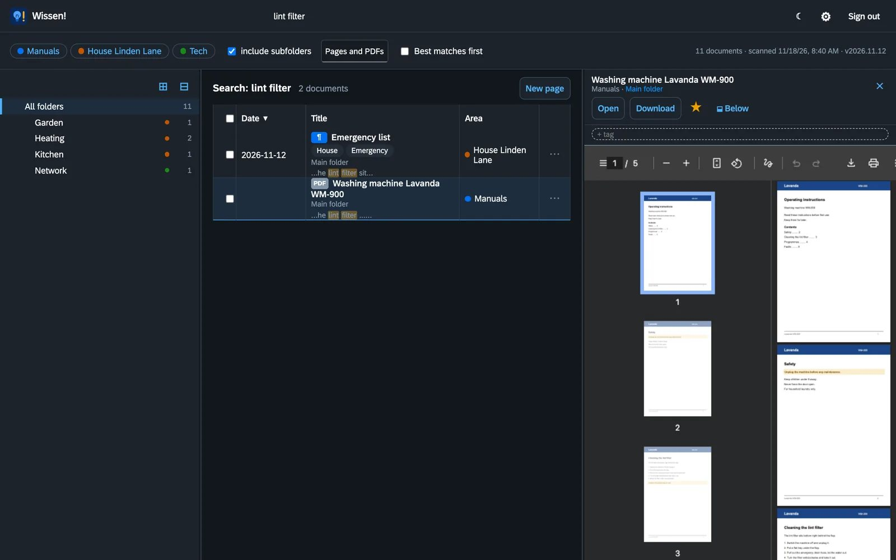
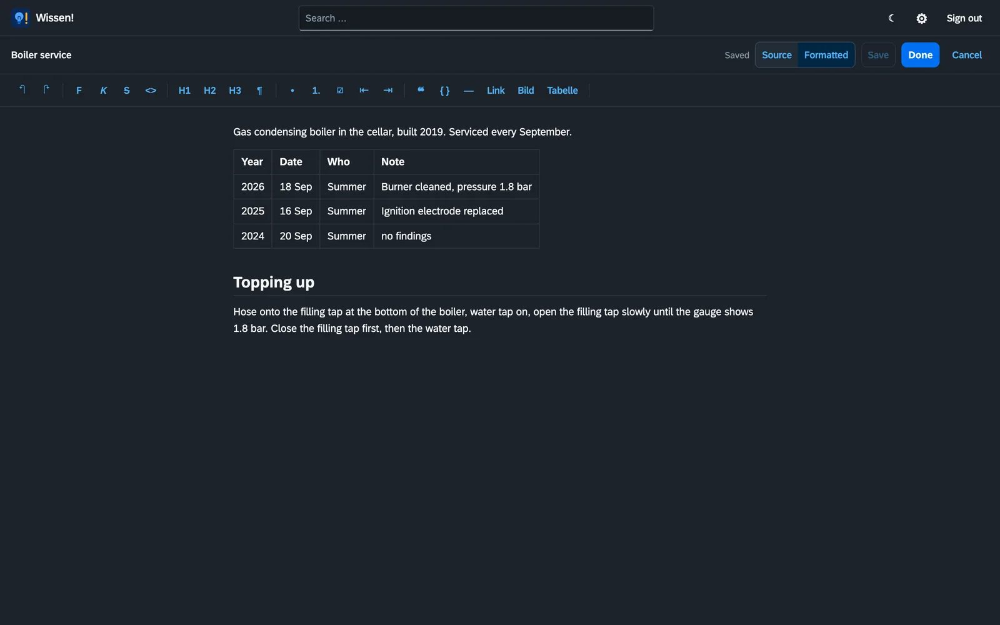
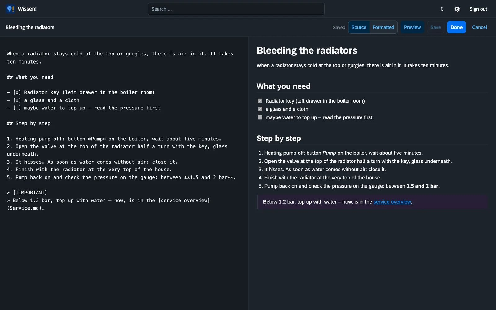

<p align="center"></p>

<h1 align="center">Wissen!</h1>

<p align="center"><b>The archive for everything you need to know: your own notes and how-tos as pages, appliance manuals as PDFs – side by side, searchable, in perfectly ordinary folders.</b><br>
Self-hosted · open source (AGPL-3.0) · German, English, French, Italian</p>

<p align="center"><a href="https://worldgate.de/en/wissen-en/"><b>Website</b></a> · <a href="https://worldgate.de/en/wissen-en/manual/">Manual</a> · <i>Deutsch: <a href="README.de.md">README.de.md</a></i></p>



*Wissen* is German for “knowledge” – and, as a verb, “to know”.

## The idea

**Folders are the truth.** A page is an ordinary Markdown file, a manual an ordinary PDF. Wissen! reads the folders, makes everything searchable and shows it. With the programme switched off the archive stays readable in any file manager – and whatever you put there by hand turns up in Wissen!.

Wissen! is the sister of [Ordnung!](https://github.com/orohde/Ordnung) (document archive) and [Augenblick!](https://github.com/orohde/Augenblick) (photos): same look, same handling.

## What it does

- **Pages and PDFs as equals.** The emergency list you write yourself and the washing machine manual sit in the same tree and turn up in the same search. A page can point straight at page 3 of a PDF (`manual.pdf#page=3`).
- **Full-text search** over titles, folders and the text of every page and every PDF, scans without a text layer included (Tesseract OCR, German and English, on your own machine). `#tag` filters by tag.
- **Questions to the archive (optional, with AI).** Type a question into the search field – Wissen! picks the fitting passages from pages and PDFs, lets an AI answer from them and names the sources down to the PDF page. Only the question and these passages go to the provider. Providers: Claude, your own Ollama server or any other OpenAI-compatible server; off until you switch it on under *Settings → AI*.
- **Two ways to write.** *Formatted* shows the page as it will look, with a toolbar for bold, lists, tasks, links, pictures and tables. *Source* shows the Markdown with the preview beside it. Wissen! remembers for your account which one you used last.
- **Writing without worry.** Saving from the formatted view rewrites only the paragraphs you touched; the rest stays in the file character for character. Before saving, Wissen! reads the result back and compares it with what you see.
- **Versions.** Every text before a save is kept, can be compared with the page as it is now and restored.
- **A lock instead of a muddle.** Whoever edits a page holds it; others see who is writing. The lock ends by itself once the editor is closed.
- **Start page.** Wissen! opens with what you pinned and what changed last. Everybody pins for themselves.
- **Callouts, task lists, tables, pictures.** A page's pictures live in a folder right next to it (`<page>.assets/`) and can be pasted or dropped in while writing.
- **New page, rename, move, trash.** When a document is renamed or moved, Wissen! corrects the links that point at it. Deleted documents stay in the trash for 30 days (adjustable) and can be put back.
- **Areas and rights.** An area is a top folder, for instance per topic, household or person. Rights are set per person and area: no access, read, or read and write.
- **Reading width and text size** by slider, remembered per account. Light and dark.
- **REST API and MCP.** Everything the interface can do works over the API as well (try it under `/api/docs`). For AI assistants there is an MCP endpoint at `/api/mcp`. Keys are made under *Settings → Connections*, read-only or read and write.
- **Second factor** for signing in, mandatory for access from outside if you like.

<table>
<tr><td></td><td></td></tr>
<tr><td></td><td></td></tr>
</table>

## Quick start with Docker

```yaml
services:
  wissen:
    image: ghcr.io/orohde/wissen:latest
    container_name: wissen
    restart: unless-stopped
    ports:
      - "8460:8000"
    volumes:
      - ./wissen:/wissen        # your pages (.md) and PDFs – every folder directly below is an area
      - ./data:/data            # index, settings, accounts, versions
    environment:
      - TZ=Europe/Berlin
```

```bash
docker compose up -d
```

Then open `http://localhost:8460`. The first visit creates the first administrator (only possible from the home network). Under **Settings → Storage** you create your first area; after that you can write pages or drop PDFs into the folder. Everything else – users, text recognition, home network, API keys – is set in the app, not in the compose file.

The image is built for `linux/amd64` and `linux/arm64` (Raspberry Pi, Apple Silicon).

### Settings

Settings are made in the app. The compose file only holds folders, the port and, if needed, the user:

| Variable | Default | Meaning |
|---|---|---|
| `PUID` / `PGID` / `UMASK` | `99` / `100` / `0002` | User, group and umask the app runs as when the container starts as root (no effect with `--user`) |
| `TZ` | `UTC` | Time zone, e.g. `Europe/Berlin` |
| `VERSIONSPRUEFUNG` | on | `0` switches the daily check for new versions off for good (see below) |
| `WISSEN_TRUSTED_PROXIES` | private ranges | Which addresses may report the client address via `X-Forwarded-For`, comma-separated (IP or network, e.g. `10.10.20.50`). Best set to your reverse proxy's address |
| `WISSEN_MAX_UPLOAD_MB` | `100` | Largest request in MB; larger ones get 413 (a single attachment stays limited to 50 MB) |

These variables only preset a fresh installation; once something is saved in the app, the app counts:

| Variable | in the app under |
|---|---|
| `WISSEN_ADMIN_USER` / `WISSEN_ADMIN_PASSWORD` | Setup page on the first visit (the variables create the account only while there is none) |
| `WISSEN_API_TOKEN` | *Settings → Connections* (taken over once) |
| `WISSEN_OCR`, `WISSEN_OCR_LANG`, `WISSEN_OCR_MAX_PAGES`, `WISSEN_RESCAN_MINUTES`, `WISSEN_TEXT_WORKERS` | *Settings → System* |
| `WISSEN_INTERNAL_NETWORKS` | *Settings → Security → Home network* |

### New versions

Once a day Wissen! asks `version.worldgate.de` whether there is a new version. If there is, administrators see a button at the top with instructions for updating. Only the name of the app, the installed version and the kind of installation (e.g. Docker) are sent – no identifier, no documents, no names. Only daily totals are stored there, no IP addresses. Switch it off under *Settings → About*, or for good with `VERSIONSPRUEFUNG=0`.

### Signing in from outside

Wissen! can tell whether a sign-in comes from the home network or from outside, also behind a reverse proxy. `X-Forwarded-For` only counts when the connection comes from a trusted proxy (`WISSEN_TRUSTED_PROXIES`, otherwise any address from a private range), and then the rightmost entry the visitor did not write themselves. Under *Settings → Security* access from outside can be limited to accounts with a second factor (authenticator app, plus ten one-time recovery codes). Sign-ins from outside, locked accounts and changes to the second factor can be reported through [ntfy](https://ntfy.sh).

### For AI assistants (MCP)

MCP access is off in a fresh installation; an administrator switches it on under *Settings → Connections*. The endpoint `/api/mcp` speaks the Model Context Protocol (streamable HTTP) and takes the same key as the REST API as `Authorization: Bearer <key>`. The tools: list areas and folders, search, read, create a page, replace it, replace a passage, append, rename, move, trash and versions. Rights, the editing lock, versions and the trash apply as in the interface; a read-only key is offered no writing tool.

## How things are stored

```
wissen/
  house/Heating/Bleeding the radiators.md
  house/Heating/Bleeding the radiators.assets/valve.jpg
  manuals/Kitchen/Dishwasher Nordwind GS-45.pdf
  .papierkorb/2026-11-18/house/Kitchen/Old note.md
```

A page's file name is its title. What else belongs to the page stands in a short head block at the top of the file:

```markdown
---
title: Bleeding the radiators
date: 2026-11-03
tags: [heating, winter]
id: 3f9a1c2b7d
---
```

The `id` stays the same through renaming and moving; versions, pins and the interface's links hang on it. SQLite is only an index and can be rebuilt from the folders at any time. Earlier versions live in the data folder (`data/versions/`), not among your pages; tags, accounts and settings are small JSON files beside them. The trash is the folder `.papierkorb` inside the archive.

## Development

```bash
python -m venv .venv && .venv/bin/pip install -e '.[dev]'
.venv/bin/python -m pytest -q
WISSEN_ARCHIVE=./wissen WISSEN_DATA=./data WISSEN_ADMIN_PASSWORD=test-password-1 .venv/bin/python -m wissen
```

Python · FastAPI · SQLite FTS5 · pypdfium2 · Tesseract · PDF.js · marked · DOMPurify · Mermaid · highlight.js · Leaflet · SAP Fundamental Styles. The interface needs no build step. Only the formatted editor (Milkdown core, ProseMirror, remark) is bundled once; the finished bundle is part of the repository, its sources and build instructions are in [`editor/`](editor/).

## Licence

[GNU Affero General Public License v3.0](LICENSE). Free software, no paid edition. More at [worldgate.de](https://worldgate.de).
